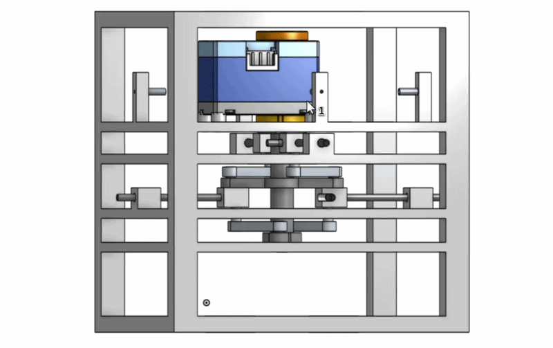
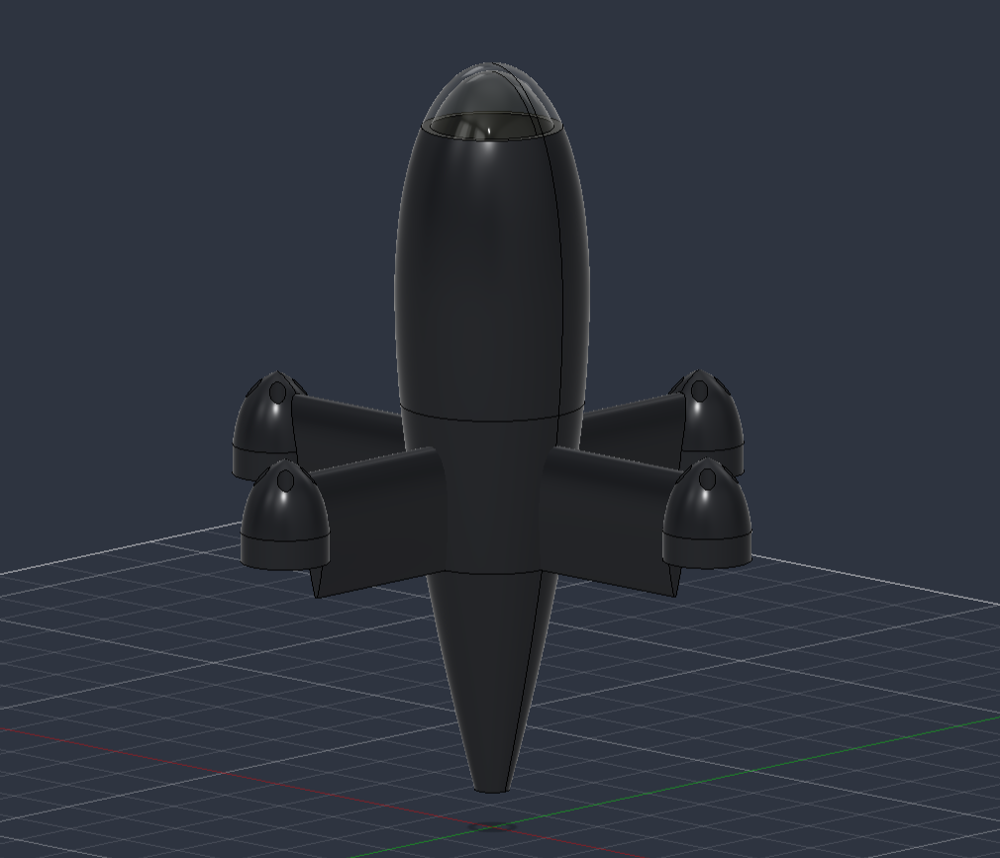

# README.md
About me: aerospace engineering student at Kent State.

# Adler Kiely

Aerospace engineering student building hardware for rockets, drones and aircraft. This page collects the projects I've designed, built and tested, along with the reasoning behind them.

---

## 2027 IREC Payload
**Kent State rocket team · 2026–present**

A servo-driven linkage that deploys four pitot probes from a CubeSat-format payload during descent to measure wind speed and direction. Includes the mechanism trade study (rack-and-pinion vs. MIT-style slider-crank), stroke and torque sizing, a full assembly modeled in Onshape and a design review.

[Project write-up →](LINK)

---

## High-speed drone
**Independent project**

Design and structural analysis of a high-speed drone, from airframe CAD to ANSYS simulation.

[Project write-up →](LINK)

---

**Currently working on:** testing the payload's deployment mechanism and building the calibration rig for the pitot array.

[LinkedIn](https://www.linkedin.com/in/adlerkiely) · [Email](mailto:adler.kiely@gmail.com)
